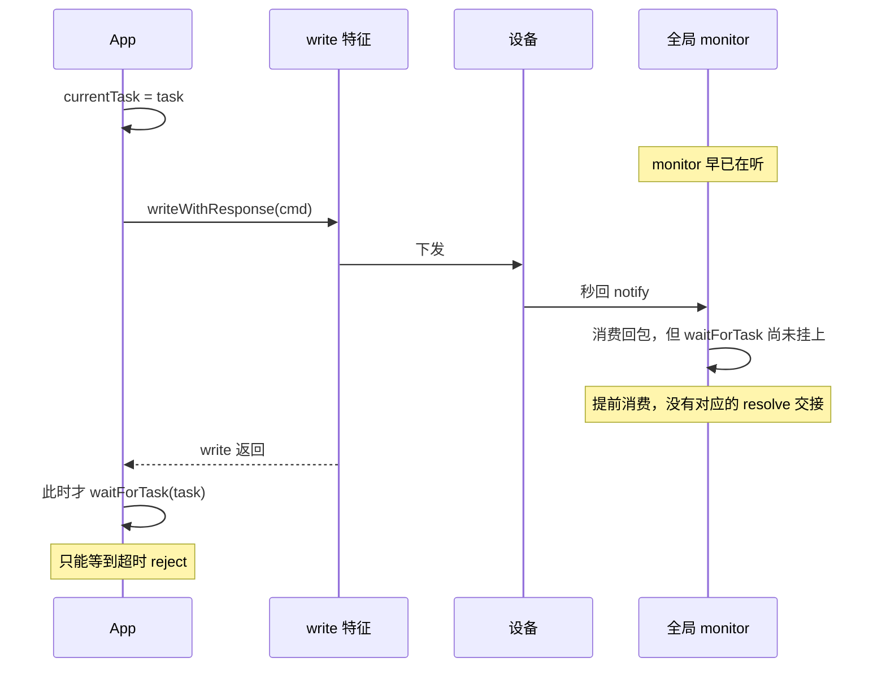

## 前言

用 `react-native-ble-plx` 做指令队列时，我以为自己已经很熟了，结果还是踩了坑。代码最初是 AI 生成的；出问题后排查了很久，根因是：本次任务的等待挂在 `write` 之后——设备秒回时，全局 `monitor` 已经把 notify 消费掉，却没有对应的 `resolve` 接住，业务侧只能等到超时。

前一家公司做蓝牙 App 时，就见过「先下发、再挂本次等待」的写法。当时觉得有隐患，也改过公司代码，但那次只是审查上的直觉，并没有线上故障可复现。

对库还不熟时，可先看官方文档：[react-native-ble-plx](https://github.com/dotintent/react-native-ble-plx)。

本文按「现象 → 问题代码 → 根因 → 修复 → 延伸」说明；顺带记一件更值得想的事：逻辑有隐患、线上却没炸时，该不该改、怎么说服别人改。

## 一、业务约定

设备端一个服务，两个特征值：

| 方向 | 特征值 | 含义 |
|------|--------|------|
| App → 设备 | write | 下发指令 |
| 设备 → App | notify | 回传结果 |

例如 App 发查询指令后，要在 notify 上拿到设备信息，再结束这次 `writeData` 的 Promise。

连接成功后，notify 特征上会挂**全局** `monitor`：一直在听，不是每次发指令才临时订阅。回包到来时，它找到当前任务并调用其 `resolve`。

这里有两层东西，后面根因会用到：

| 层级 | 作用 |
|------|------|
| 全局 `monitor` | 接收 BLE notify |
| 本次任务的等待（`waitForTask` / `task.resolve`） | 把这次回包交接给业务 Promise |

监听负责「收到」；等待负责「交给这次发送的调用方」。两层都就绪，一次指令才算完整。

## 二、问题现象

| 维度 | 情况 |
|------|------|
| 触发场景 | 高频下发 + 设备端几乎秒回 |
| 表面表现 | 跑一段时间后卡住，等到超时长才失败 |
| 误导点 | 前面多次成功，容易怀疑设备端 |
| 真实结果 | notify 已被全局 monitor 消费，本次等待尚未挂上，没有对应的 `resolve` 接住 |

复现侧接近：

```ts
setInterval(async () => {
  await bluetoothManager.writeData({
    method: "sendCommand",
    params: command,
  });
}, 150);
```

设备端（自写 Python）为了验链路，收到就回。设备处理慢时，「先写再挂等待」往往碰巧没事；秒回时隐患会被放大。

## 三、问题代码

### 1. 入队

```ts
async writeData(data: Command): Promise<unknown> {
  const id = Date.now();
  const payload = JSON.stringify({ id, ...data });

  return new Promise((resolve, reject) => {
    this.tasks.push({ id, payload, resolve, reject });
    void this._send();
  });
}
```

### 2. 全局 monitor（示意）

```ts
// 连接后只订阅一次
this.notifyCharacteristic.monitor((error, characteristic) => {
  if (error || !characteristic?.value) return;

  const task = this.currentTask;
  if (!task) return;

  try {
    const data = JSON.parse(
      Buffer.from(characteristic.value, "base64").toString("utf8"),
    );
    task.resolve(data);
  } catch (e) {
    task.reject(e);
  }
});
```

### 3. 错误：先写，再挂本次等待

```ts
private async _send(): Promise<void> {
  if (this.sending) return;
  this.sending = true;

  while (this.tasks.length > 0) {
    const task = this.tasks.shift();
    if (!task) continue;

    this.currentTask = task;

    try {
      if (!this.canWrite || !this.writeCharacteristic) {
        task.reject(new Error("设备不支持写入或未正确连接"));
        break;
      }

      const base64 = Buffer.from(task.payload, "utf8").toString("base64");

      // 1) 先下发 —— 设备可能在此期间秒回
      await this.writeCharacteristic.writeWithResponse(base64);

      // 2) 此时才挂上本次等待 —— 回包若已来过，等于消费了却无人接住
      await this.waitForTask(task, 100_000);
    } catch (error) {
      console.error("发送任务失败:", error);
      task.reject(error);
    } finally {
      this.currentTask = null;
    }
  }

  this.sending = false;
}

private waitForTask(task: BleTask, timeoutMs: number): Promise<unknown> {
  return new Promise((resolve, reject) => {
    const timer = setTimeout(() => {
      reject(new Error("命令响应超时"));
    }, timeoutMs);

    const { resolve: userResolve, reject: userReject } = task;

    task.resolve = (data) => {
      clearTimeout(timer);
      userResolve(data);
      resolve(data);
    };
    task.reject = (error) => {
      clearTimeout(timer);
      userReject(error);
      reject(error);
    };
  });
}
```

关键顺序可以缩成：

```ts
await this.writeCharacteristic.writeWithResponse(base64);
await this.waitForTask(task, 100_000); // 等待挂在 write 之后
```

## 四、根因分析

### 1. 排查过程

一开始更怀疑设备端——第一次写设备侧逻辑，成功过几次也不敢自信。但连接未断、用其它 App 测也正常时，应按理把焦点转回 App。

卡住最终走超时 `reject`，说明业务侧的 `resolve` 从未被等到。日志和设备侧都表明有回包，全局 `monitor` 也一直开着。继续顺着代码模拟执行，问题收束到 `_send` 里 **`writeWithResponse` 与 `waitForTask` 的先后**：等待挂在 write 返回之后。

### 2. 机制：提前消费，没有对应的等待者

系统里其实一直有人在「听」——全局 `monitor`。失败不是因为没收到 BLE 数据，而是收到之后的交接断了。

具体链路：

1. `currentTask = task` 已设置，`monitor` 回调能找到「当前任务」这个对象。
2. 但 `waitForTask` 还没执行：用来把回包交给业务 Promise、并结束本次 `await` 的那层包装尚未挂上。
3. 设备秒回 → `monitor` 触发 → 调用当时的 `task.resolve`（仍是入队时的原始 resolve，或等价地：没有与 `waitForTask` 绑在一起的那套逻辑）。
4. 这一包 notify 已经被回调消费掉了。
5. 随后 `writeWithResponse` 返回，才执行 `waitForTask`，开始空等；只能等到超时。

所以根因应表述为：

> **回包被全局监听提前消费了，但当时没有对应的等待者把这次消费交接成业务上的完成。**

两层不同步时，表现就是「有监听、有回包、业务却超时」。

### 3. 时序



设备慢时，回包常落在 `waitForTask` 之后，问题被掩盖；秒回 + 高频下发时更容易打中。前面多次成功，只说明还有别的时序因素，不否定这个隐患。

另外：若 `waitForTask` 在 `write` **之前**就已挂好，即便 notify 打在 `writeWithResponse` 尚未返回期间，`monitor` 也能把结果交给本次等待，后面的 `await waiting` 会立刻结束。因此关键不是「两个 `await` 谁先写在源码里」，而是 **等待是否在下发前就已经就绪**。

## 五、修复方式

**先挂好本次等待，再 write。** 全局 monitor 不用改；改的是「这次任务何时具备可被交接的 `resolve`」。

```ts
private async _send(): Promise<void> {
  if (this.sending) return;
  this.sending = true;

  while (this.tasks.length > 0) {
    const task = this.tasks.shift();
    if (!task) continue;

    this.currentTask = task;

    try {
      if (!this.canWrite || !this.writeCharacteristic) {
        task.reject(new Error("设备不支持写入或未正确连接"));
        break;
      }

      // 1) 先挂等待 —— 之后 monitor 消费回包时有人接住
      const waiting = this.waitForTask(task, 100_000);

      const base64 = Buffer.from(task.payload, "utf8").toString("base64");

      // 2) 再下发
      await this.writeCharacteristic.writeWithResponse(base64);

      // 3) 等交接结果（秒回若已在 write 期间到达，这里会立刻结束）
      await waiting;
    } catch (error) {
      console.error("发送任务失败:", error);
      task.reject(error);
    } finally {
      this.currentTask = null;
    }
  }

  this.sending = false;
}
```

对照：

```ts
// 错：先写，再挂等待 —— 可能被提前消费且无人接住
await writeWithResponse(base64);
await waitForTask(task, timeout);

// 对：先挂等待，再写，再 await 同一个 waiting
const waiting = waitForTask(task, timeout);
await writeWithResponse(base64);
await waiting;
```

## 六、延伸：线上没炸，还要不要改？

发现逻辑隐患、但线上暂时没事时，不宜凭感觉直接改。更稳妥的是：**先找到可复现路径，再拿结果说服人**。

1. 觉得「后端突然返回空」会炸，就模拟空数据。
2. 觉得「先写再挂等待」会丢交接，就用秒回设备 + 高频下发把它打出来。

复现成立，改动才有依据；复现不成立，回头检查推理哪里漏了。

## 结尾

每次发送都要在 write 之前挂好本次等待。否则秒回那一包会被全局 `monitor` 提前消费，业务 Promise 却没有对应的人接住，最后只能超时。
