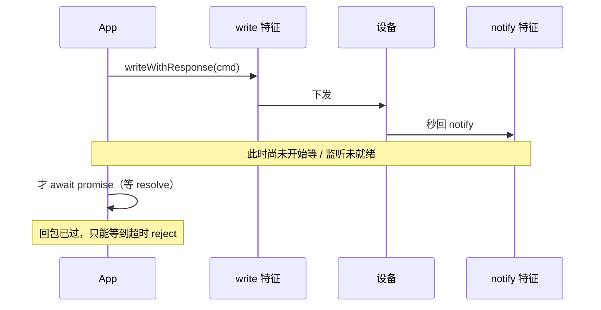

前置阅读：[react-native-ble-plx 权威指南](https://juejin.cn/post/7212450663922073656)（对库还不熟时可先看）。

## 1、背景

用 `react-native-ble-plx` 做指令队列时，我以为自己已经很熟了，结果还是踩了坑。代码最初是 AI 生成的；出问题后排查了很久，根因其实我以前就知道——只是两行代码的执行顺序不同。

前一家公司做蓝牙 App 时，就见过「先下发、再监听」的写法。当时觉得有隐患，也改过公司代码，但那次只是代码审查上的直觉，并没有线上故障可复现。

这点顺序问题本身不「大」，更值得记下来的是另一件事：如果你觉得一段逻辑有隐患，但线上从没炸过，你该不该改？该怎么说服别人改？

## 2、业务约定

设备端定义一个服务，下面两个特征值：

| 方向 | 特征值 | 含义 |
|------|--------|------|
| App → 设备 | write | 下发指令 |
| 设备 → App | notify | 回传结果 |

例如 App 发 `AT+deviceInfo=?\r\n`，需要在 notify 特征上收到设备信息，再结束这次 `writeData` 的 Promise。

## 3、问题现象

| 维度 | 情况 |
|------|------|
| 触发场景 | 高频下发 + 设备端几乎秒回 |
| 表面表现 | 跑一段时间后卡住，要等超时长才失败 |
| 误导点 | 前面多次成功，容易怀疑设备端蓝牙 |
| 真实结果 | notify 先到、监听后挂上，响应被丢掉，`resolve` 永不触发 |

复现侧接近这样：

```ts
setInterval(async () => {
  await bluetoothManager.writeData({
    method: "sendCommand",
    params: command,
  });
}, 150);
```

设备端（我自己写的 Python）为了验证链路，收到就回，几乎没有业务延迟。前一家公司设备处理较慢，先写后听往往「碰巧」没事；这次秒回，隐患就被放大了。

## 4、问题代码

`writeData` 只把任务推进队列，真正发送在 `_send`：

```ts
async writeData(data: Command): Promise<any> {
  const id = Date.now();
  const sendStr = JSON.stringify({ id, ...data });

  return new Promise((resolve, reject) => {
    this.tasks.push({
      payload: sendStr,
      resolve,
      reject,
      id,
    });
    this._send();
  });
}

private async _send(): Promise<void> {
  if (this.sending) {
    return;
  }
  this.sending = true;

  while (this.tasks.length > 0) {
    const task = this.tasks.shift();
    if (!task) continue;
    this.currentTask = task;
    let timer: ReturnType<typeof setTimeout> | null = null;

    try {
      if (!this.canWrite || !this.writeCharacteristic) {
        task.reject?.(new Error("设备不支持写入或未正确连接"));
        this.currentTask = null;
        break;
      }

      const promise = Promise.race([
        new Promise((resolve, reject) => {
          const originalResolve = task.resolve;
          task.resolve = (data: any) => {
            originalResolve?.(data);
            resolve(data);
            if (timer) clearTimeout(timer);
          };
          const originalReject = task.reject;
          task.reject = (error: any) => {
            originalReject?.(error);
            reject(error);
            if (timer) clearTimeout(timer);
          };
        }),
        new Promise((_, reject) => {
          timer = setTimeout(() => {
            task.reject?.(new Error("命令响应超时"));
            reject(new Error("命令响应超时"));
          }, 100000);
        }),
      ]);

      const Buffer = require("buffer").Buffer;
      const base64 = Buffer.from(task.payload, "utf8").toString("base64");

      // 隐患：先写，再等「监听侧」把 task.resolve 调起来
      await this.writeCharacteristic.writeWithResponse(base64);
      await promise;

      this.currentTask = null;
    } catch (error) {
      console.error("等待任务完成时出错:", error);
      this.currentTask = null;
    } finally {
      if (timer) clearTimeout(timer);
    }
  }

  this.sending = false;
}
```

关键片段可以缩成：

```ts
await this.writeCharacteristic.writeWithResponse(base64);
await promise; // promise ≈「等 notify 回调里 resolve」
```

这里的 `promise` 依赖监听路径去消费 `task.resolve`。写在前、听在后，响应就可能落在监听窗口之外。

## 5、分析问题

### 5.1、排查路径

一开始更怀疑设备端——第一次写 Python 蓝牙逻辑，成功过几次也不敢自信。但设备只要成功过一次，在连接未断的前提下不该「突然永远不回」；用其他 App 测也正常。于是把注意力转回 App。

卡住说明最终是超时走了 `reject`，也就是 `resolve` 从未被调用。`resolve` 挂在 notify 路径上：没收齐回调，要么设备没发，要么发了但 App 没接到。设备侧已排除后，只剩一种合理解释——**回包到了，监听还没挂上**。

### 5.2、时序



先写后听在「设备处理慢」时常常蒙混过关；设备秒回 + 150ms 轮询时，丢包与卡住就稳定出现。前面多次成功并不否定隐患——还有调度、缓冲等因素，但顺序错误是充分条件之一。

## 6、修复方式

把「准备好接收」放到「写入」之前：先挂好本次任务的等待 / 监听，再 `writeWithResponse`。

```ts
const Buffer = require("buffer").Buffer;
const base64 = Buffer.from(task.payload, "utf8").toString("base64");

// 先进入等待（监听路径已能 resolve 当前 task）
const waiting = promise;
await this.writeCharacteristic.writeWithResponse(base64);
await waiting;
```

若监听是单独 `monitor` / 订阅，同样要保证：**订阅完成后再写**。调换顺序后，同样的高频秒回场景下不再卡死。

## 7、延伸：线上没炸，还要不要改？

发现逻辑隐患、但线上暂时没事时，不宜凭感觉直接改——猜测和真实有时不一致，改动本身也可能引入回归。

更稳妥的做法是：**先找到可复现路径，再拿复现结果说服人**。

- 觉得「后端突然返回空」会炸，就模拟空数据，看线上逻辑是否如你所料。
- 觉得「先写后听」会丢包，就用秒回设备 + 高频下发把它打出来。

复现成立，改动才有依据；复现不成立，回头检查自己的推理哪里漏了。态度上是把问题查到底，而不是在环境或运气上停住。
