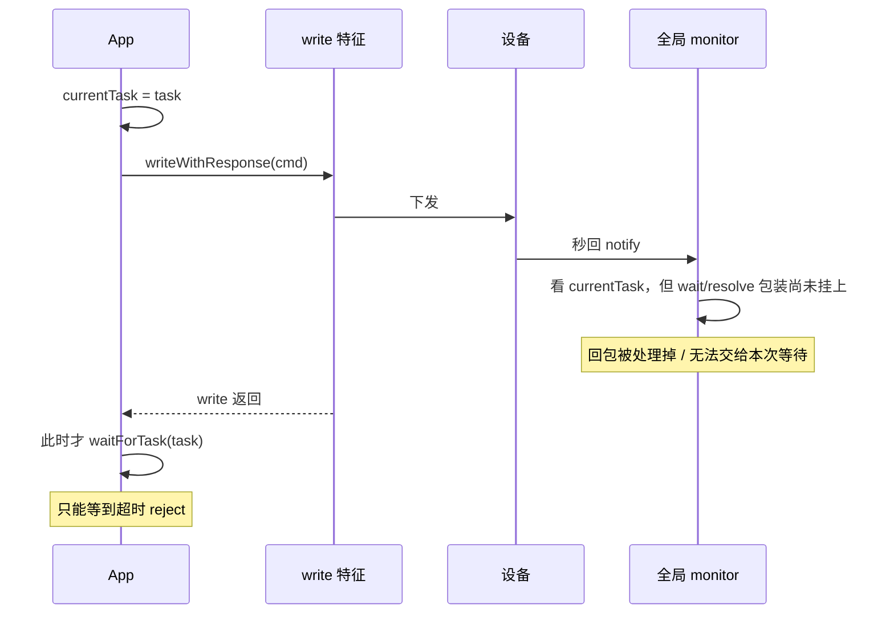

## 前言

用 `react-native-ble-plx` 做指令队列时，我以为自己已经很熟了，结果还是踩了坑。代码最初是 AI 生成的；出问题后排查了很久，根因其实只是「本次任务的等待」挂得太晚——不是没开监听，而是**等的人来晚了**。

前一家公司做蓝牙 App 时，就见过「先下发、再挂等待」的写法。当时觉得有隐患，也改过公司代码，但那次只是审查上的直觉，并没有线上故障可复现。

对库还不熟时，可先看官方文档：[react-native-ble-plx](https://github.com/dotintent/react-native-ble-plx)。

本文按「现象 → 错误理解 → 问题代码 → 根因 → 修复 → 延伸」说明；顺带记一件更值得想的事：逻辑有隐患、线上却没炸时，该不该改、怎么说服别人改。

## 一、业务约定

设备端一个服务，两个特征值：

| 方向 | 特征值 | 含义 |
|------|--------|------|
| App → 设备 | write | 下发指令 |
| 设备 → App | notify | 回传结果 |

例如 App 发查询指令后，要在 notify 上拿到设备信息，再结束这次 `writeData` 的 Promise。

连接成功后，notify 特征上会挂**全局** `monitor`：一直在听，不是每次发指令才临时订阅。回包到来时，它找到当前任务并 `resolve`。

## 二、问题现象

| 维度 | 情况 |
|------|------|
| 触发场景 | 高频下发 + 设备端几乎秒回 |
| 表面表现 | 跑一段时间后卡住，等到超时长才失败 |
| 误导点 | 前面多次成功，容易怀疑设备端 |
| 真实结果 | 回包已被全局 monitor 处理掉，本次任务的等待还没挂上，`resolve` 永远等不来 |

复现侧接近：

```ts
setInterval(async () => {
  await bluetoothManager.writeData({
    method: "sendCommand",
    params: command,
  });
}, 150);
```

设备端（自写 Python）为了验链路，收到就回。设备处理慢时，「先写再挂等待」往往碰巧没事；秒回时隐患会被放大。

## 三、容易误判的一点

有人看到：

```ts
await this.writeCharacteristic.writeWithResponse(base64);
await promise;
```

就以为问题是「两个 `await` 的先后」。**不对。**

`promise` 若在 `write` **之前**就已经创建，并且已经把 `task.resolve` 接到等待器上，那全局 monitor 在 `writeWithResponse` 尚未返回时打进来，也能正确 `resolve`，后面的 `await promise` 只是拿到已完成的结果。

真正危险的是：

> **先 `writeWithResponse`，等它返回之后，才创建本次任务的 `promise` / 改写 `task.resolve`，再 `await`。**

全局监听一直都在；回包来得早时，monitor 已经按「当前任务」处理过一遍，而那时等待器还没挂上——响应等于被消费掉了，后面再建的 `promise` 自然永远等不到。

## 四、问题代码

### 1. 入队

```ts
async writeData(data: Command): Promise<unknown> {
  const id = Date.now();
  const payload = JSON.stringify({ id, ...data });

  return new Promise((resolve, reject) => {
    this.tasks.push({ id, payload, resolve, reject });
    void this._send();
  });
}
```

### 2. 全局 monitor（示意）

```ts
// 连接后只订阅一次
this.notifyCharacteristic.monitor((error, characteristic) => {
  if (error || !characteristic?.value) return;

  const task = this.currentTask;
  if (!task) return; // 没有「正在等」的任务，回包被丢掉

  try {
    const data = JSON.parse(
      Buffer.from(characteristic.value, "base64").toString("utf8"),
    );
    task.resolve(data);
  } catch (e) {
    task.reject(e);
  }
});
```

### 3. 错误：先写，再挂等待

```ts
private async _send(): Promise<void> {
  if (this.sending) return;
  this.sending = true;

  while (this.tasks.length > 0) {
    const task = this.tasks.shift();
    if (!task) continue;

    this.currentTask = task;

    try {
      if (!this.canWrite || !this.writeCharacteristic) {
        task.reject(new Error("设备不支持写入或未正确连接"));
        break;
      }

      const base64 = Buffer.from(task.payload, "utf8").toString("base64");

      // 1) 先下发 —— 设备可能在此期间秒回
      await this.writeCharacteristic.writeWithResponse(base64);

      // 2) 此时才挂上「本次等待」—— 晚了
      //    全局 monitor 若已处理过回包，这里再等也等不到
      await this.waitForTask(task, 100_000);
    } catch (error) {
      console.error("发送任务失败:", error);
      task.reject(error);
    } finally {
      this.currentTask = null;
    }
  }

  this.sending = false;
}

private waitForTask(task: BleTask, timeoutMs: number): Promise<unknown> {
  return new Promise((resolve, reject) => {
    const timer = setTimeout(() => {
      reject(new Error("命令响应超时"));
    }, timeoutMs);

    const { resolve: userResolve, reject: userReject } = task;

    task.resolve = (data) => {
      clearTimeout(timer);
      userResolve(data);
      resolve(data);
    };
    task.reject = (error) => {
      clearTimeout(timer);
      userReject(error);
      reject(error);
    };
  });
}
```

关键顺序可以缩成：

```ts
await this.writeCharacteristic.writeWithResponse(base64);
await this.waitForTask(task, 100_000); // 等待器建在 write 之后
```

## 五、根因分析

### 1. 排查路径

一开始更怀疑设备端。但连接未断、其它 App 也能通时，应把焦点转回 App。

卡住最终走超时 `reject`，说明本次 `resolve` 从未被调用。全局 monitor 一直在，设备也在回——更合理的解释是：**回包到达时，本次任务的等待还没挂上，monitor 按「无有效等待 / 已处理」把这次 notify 消费掉了**；之后再 `waitForTask`，只能空等。

### 2. 时序



设备慢时，回包常落在 `waitForTask` 之后，问题被掩盖；秒回 + 高频下发时更容易打中。前面多次成功，只说明还有别的时序因素，不否定这个顺序隐患。

## 六、修复方式

**先挂好本次等待，再 write。** 全局 monitor 不变；变的是「这次任务何时开始能被正确 resolve」。

```ts
private async _send(): Promise<void> {
  if (this.sending) return;
  this.sending = true;

  while (this.tasks.length > 0) {
    const task = this.tasks.shift();
    if (!task) continue;

    this.currentTask = task;

    try {
      if (!this.canWrite || !this.writeCharacteristic) {
        task.reject(new Error("设备不支持写入或未正确连接"));
        break;
      }

      // 1) 先挂等待 —— monitor 从此可以把回包交给 task
      const waiting = this.waitForTask(task, 100_000);

      const base64 = Buffer.from(task.payload, "utf8").toString("base64");

      // 2) 再下发
      await this.writeCharacteristic.writeWithResponse(base64);

      // 3) 等结果（若秒回已在 write 期间到达，这里会立刻结束）
      await waiting;
    } catch (error) {
      console.error("发送任务失败:", error);
      task.reject(error);
    } finally {
      this.currentTask = null;
    }
  }

  this.sending = false;
}
```

对照：

```ts
// 错：先写，再等
await writeWithResponse(base64);
await waitForTask(task, timeout);

// 对：先等，再写，再 await 同一个 waiting
const waiting = waitForTask(task, timeout);
await writeWithResponse(base64);
await waiting;
```

## 七、延伸：线上没炸，还要不要改？

发现逻辑隐患、但线上暂时没事时，不宜凭感觉直接改。更稳妥的是：**先找到可复现路径，再拿结果说服人**。

1. 觉得「后端突然返回空」会炸，就模拟空数据。
2. 觉得「先写后挂等待」会丢包，就用秒回设备 + 高频下发把它打出来。

复现成立，改动才有依据；复现不成立，回头检查推理哪里漏了。

## 结尾

全局 `monitor` 一直开着，不等于每次指令都「已经在听」。对队列里的每一次发送，仍要先挂上本次任务的等待，再 `write`——否则秒回的那一包，会被全局监听先处理掉，而业务 Promise 只能等到超时。
