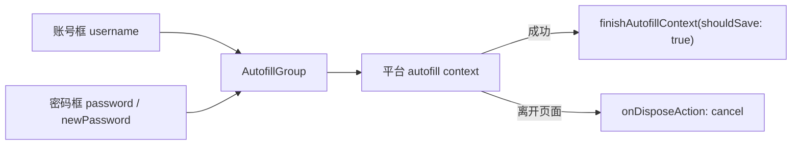

App 走账号密码登录。它不是用户每天都打开的主流产品，账号密码往往记不住、也不愿意再记一份。接入系统自动填充后，注册或登录成功时把凭证交给系统密码管理；下次打开直接一键填入，少记一套凭据。

下面按 Flutter 的接入方式说明：字段怎么分组、hint 怎么标、什么时候才真正触发「保存」。

## 自动填充在 Flutter 里怎么工作

平台侧（iOS 钥匙串 / Android Autofill）认的是一组「当前正在填写的字段」。Flutter 把这组字段抽象成 **autofill context**，核心有三块：

| API | 作用 |
|-----|------|
| [`AutofillGroup`](https://api.flutter.dev/flutter/widgets/AutofillGroup-class.html) | 把同一次填写相关的输入框绑成一组，一起参与填充与保存 |
| [`autofillHints`](https://api.flutter.dev/flutter/material/TextField/autofillHints.html) | 告诉系统每个框的语义（账号 / 密码 / 新密码） |
| [`TextInput.finishAutofillContext`](https://api.flutter.dev/flutter/services/TextInput/finishAutofillContext.html) | 结束当前 context；`shouldSave: true` 时平台会提示保存 |

同组字段要一起 build；hint 用 [`AutofillHints`](https://api.flutter.dev/flutter/services/AutofillHints-class.html) 里的标准值，平台才更容易对上密码管理服务。



## 密码登录：一组账号 + 密码

登录页的密码模式用 `AutofillGroup` 包住账号框和密码框，分别打上 `username` 与 `password`：

```dart
AutofillGroup(
  onDisposeAction: AutofillContextAction.cancel,
  child: Column(
    children: [
      TextField(
        controller: accountController,
        autofillHints: const [AutofillHints.username],
        textInputAction: TextInputAction.next,
        onSubmitted: (_) => passwordFocus.requestFocus(),
      ),
      TextField(
        controller: passwordController,
        obscureText: true,
        autofillHints: const [AutofillHints.password],
        textInputAction: TextInputAction.go,
        onSubmitted: (_) => onLogin(),
      ),
      // 协议、登录按钮…
    ],
  ),
)
```

密码框也可以抽成组件，默认 hint 就是 `AutofillHints.password`，登录页直接用默认值即可。

`TextInputAction.next` / `go` 和自动填充无关，但和填充后的键盘路径一致：账号回车跳密码，密码回车提交，少一次点按钮。

## 只在成功时保存

`AutofillGroup` 默认的 `onDisposeAction` 是 [`AutofillContextAction.commit`](https://api.flutter.dev/flutter/widgets/AutofillContextAction.html)：顶层 Group 销毁时会按「建议保存」结束 context。登录页用户随时可能切验证码登录、返回上一页，这时并不该弹「是否保存密码」。

所以这里显式写成 `cancel`：销毁时不保存。真正保存放在业务成功回调里：

```dart
Future<void> onLoginSuccess() async {
  TextInput.finishAutofillContext(shouldSave: true);
  // toast、跳转首页…
}
```

对应关系可以记成：

| 时机 | 行为 |
|------|------|
| 登录 / 注册 / 重置成功 | `finishAutofillContext(shouldSave: true)` |
| 页面或弹层销毁、用户中途离开 | `onDisposeAction: cancel` → 相当于 `shouldSave: false` |

验证码登录没有密码字段，不必进这套保存流程；只在密码登录成功分支调用即可。

## 注册 / 重置密码：补上隐藏账号框

注册、忘记密码的最后一步通常只有「新密码 + 确认密码」。系统保存凭据需要账号和密码成对出现；只有密码框时，保存结果往往不完整。

做法是：把上一步已经确认的账号放进隐藏的 `TextField`，和新密码框放进同一个 `AutofillGroup`。新密码用 `AutofillHints.newPassword`，确认框不参与自动填充（`autofillHints: []` 或传 `null`）：

```dart
AutofillGroup(
  onDisposeAction: AutofillContextAction.cancel,
  child: Column(
    children: [
      Offstage(
        child: TextField(
          controller: accountController, // 已填入当前账号
          autofillHints: const [AutofillHints.username],
          enableSuggestions: false,
          decoration: const InputDecoration(border: InputBorder.none),
        ),
      ),
      TextField(
        controller: passwordController,
        obscureText: true,
        autofillHints: const [AutofillHints.newPassword],
      ),
      TextField(
        controller: confirmController,
        obscureText: true,
        autofillHints: const [], // 确认框不参与 autofill
      ),
    ],
  ),
)
```

注册成功、重置成功同样调用：

```dart
TextInput.finishAutofillContext(shouldSave: true);
```

这样系统拿到的是「账号 + 新密码」一对，下次登录页的 `username` / `password` 才能对得上。

## 小结

1. 用 `AutofillGroup` 把同一次填写的账号、密码绑在一起，并打上标准 `AutofillHints`。
2. 销毁默认用 `cancel`，避免中途离开也弹保存；只在登录 / 注册 / 重置成功时 `finishAutofillContext(shouldSave: true)`。
3. 只有密码的步骤用隐藏账号框补齐凭据对，新密码用 `newPassword`。

官方文档：[AutofillGroup](https://api.flutter.dev/flutter/widgets/AutofillGroup-class.html)、[TextInput.finishAutofillContext](https://api.flutter.dev/flutter/services/TextInput/finishAutofillContext.html)、[TextField.autofillHints](https://api.flutter.dev/flutter/material/TextField/autofillHints.html)。
