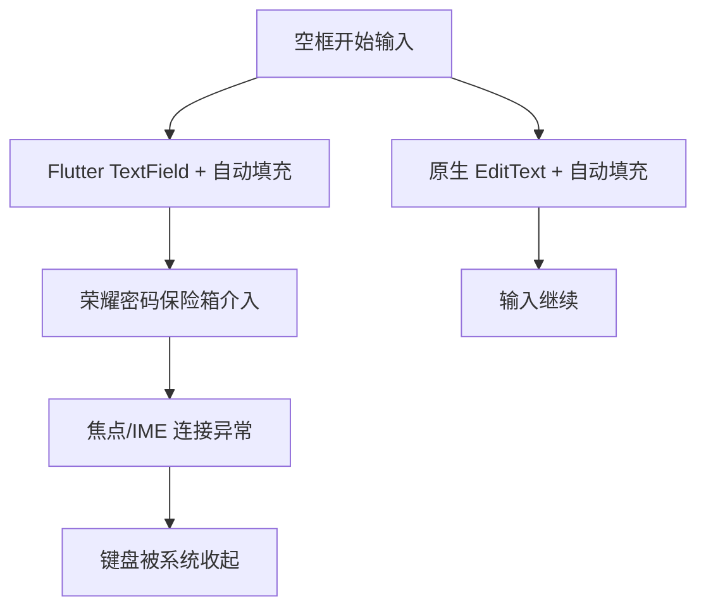

## 问题现象

测试机：**荣耀 Magic 8 Pro Air**。登录页已接入系统自动填充（见同项目功能实现：[Flutter 登录接入系统自动填充](/companies/yiyuan/projects/a/features/flutter-login-system-autofill)）。

| 条件 | 表现 |
|------|------|
| 密码保险箱里**没有**已存账号 | 账号、密码均可正常输入 |
| 密码保险箱里**已有**账号 | 空框开始输入时键盘会被系统收起 |
| iOS 15 | 正常 |
| 关闭密码保险箱后再测 | 恢复正常 |

保险箱里已有账号时，账号框和密码框表现还不一样：

**账号框（空框开始敲）：**

- 敲的字符与已存账号前缀**匹配**：前三个字能打进去，第四个字即便仍匹配，键盘也会消失。
- 第一个字符就**不匹配**：键盘立刻消失。

**密码框：**

- 无论是否匹配已存密码，一敲就消失。

聚焦时密码保险箱提示可以出来，键盘也能起来；真正出问题的是**开始输入之后**。

## 问题分析

关掉密码保险箱后输入立刻正常，说明触发条件就是保险箱。但这不等于「这台荣耀用不了自动填充」——别的原生 App 在同一台机上可以一边出保险箱提示、一边继续打字。更合理的怀疑是：当前实现里某个属性或某层封装，和保险箱抢焦点的行为撞车了。

业务登录页干扰项不少：业务层自动填充封装、键盘顶起避免遮挡输入框的布局逻辑等。要先把这些干扰降到最低，再下结论。注意：最小复现**仍然保留自动填充**——没有 `autofillHints` 时输入是正常的，关掉自动填充等于绕开问题，并不能证明 Flutter 输入框本身没问题。

## 最小复现

写一个尽量干净的页面：普通 Flutter `TextField`，带上 `AutofillGroup` / `autofillHints`，但去掉业务封装，也去掉「防键盘遮挡」相关逻辑。

| 最小页配置 | 保险箱有账号时 |
|------------|----------------|
| Flutter `TextField` + 自动填充 | **仍复现**键盘消失 |
| 同样干净，但不挂自动填充 | 正常 |

说明：

- 问题不在业务布局或防遮挡逻辑；
- 触发链是 **Flutter `TextField` + 自动填充**，和荣耀密码保险箱撞上了；
- 「去掉自动填充就正常」只说明保险箱是条件，不能当成业务侧的最终解法——产品仍需要自动填充。

## 对照实验：原生 EditText 正常

同一台机器、同样开着密码保险箱、同样有已存账号、同样声明自动填充，用原生 `EditText` 做对照：

| 实现 | 保险箱有账号时，空框输入 |
|------|--------------------------|
| Flutter `TextField` + 自动填充 | 键盘消失（现象同上） |
| 原生 `EditText` + 自动填充 | 正常 |

于是可以收窄结论：

- 不是「密码保险箱本身不能用」；
- 是 **Flutter 的 `TextField` 这条自动填充输入链路** 在荣耀保险箱弹出 / 抢焦点时，键盘被系统收掉；
- iOS 上 Flutter `TextField` + 自动填充没问题，不必换实现。

排查过程中系统输入法日志里，还能看到收起原因类似 `HIDE_SAME_WINDOW_FOCUSED_WITHOUT_EDITOR`：保险箱相关窗口抢走焦点后，焦点回到应用窗口时，系统判定当时没有编辑器，于是把 IME 关掉。这和「原生 EditText 能扛住、Flutter TextField 扛不住」是同一类焦点/IME 生命周期差异，而不是业务代码主动 `unfocus`。



## 处理方案

按平台分流：

- **iOS**：继续用 Flutter `TextField` + 现有 `AutofillGroup` / `AutofillHints`。
- **Android**：登录相关输入框改走原生 `EditText`，通过 `AndroidView`（PlatformView）嵌进现有 `AppTextField` 外观里；`autofillHints`、焦点、文本变更用 MethodChannel 与 Dart 侧同步。

Dart 侧按平台分支（示意）：

```dart
Widget _field(...) {
  if (defaultTargetPlatform == TargetPlatform.android) {
    return Focus(
      focusNode: focusNode,
      child: AndroidView(
        viewType: 'smart_wheelchair/native_text_field',
        creationParams: {
          'text': controller.text,
          'obscureText': obscureText,
          'autofillHints': autofillHints?.toList() ?? const <String>[],
          // …
        },
        creationParamsCodec: const StandardMessageCodec(),
      ),
    );
  }

  return TextField(
    controller: controller,
    focusNode: focusNode,
    autofillHints: autofillHints,
    // …
  );
}
```

Android 侧注册 PlatformView，用原生 `EditText` 承接自动填充：

```kotlin
if (Build.VERSION.SDK_INT >= Build.VERSION_CODES.O) {
    importantForAutofill = View.IMPORTANT_FOR_AUTOFILL_YES
    autofillHints
        .takeIf { it.isNotEmpty() }
        ?.let { setAutofillHints(*it.toTypedArray()) }
}
```

外观（圆角底、浮动 hint、错误描边）仍由 Flutter 画；真正吃键盘事件和保险箱的是原生控件。这样自动填充能力保留，荣耀上也不会再因为保险箱把键盘打没。

## 小结

1. **复现条件**：荣耀 Magic 8 Pro Air + 密码保险箱已有账号 + Flutter `TextField` 自动填充 + 空框输入。
2. **账号框**对前缀匹配更「宽容」（大约三个字符），**密码框**一敲就收键盘；关保险箱、去掉自动填充或换 iOS 则正常。
3. **最小页仍带自动填充时 Flutter 复现，去掉自动填充正常；同条件原生 EditText 正常** → 判定为 Flutter 自动填充输入链路与荣耀保险箱的兼容问题，而不是业务布局，也不是「机型不能用保险箱」。
4. **落地**：iOS 继续 Flutter；Android 登录输入改 PlatformView 原生 `EditText`，自动填充 hint 仍由原生侧声明。
