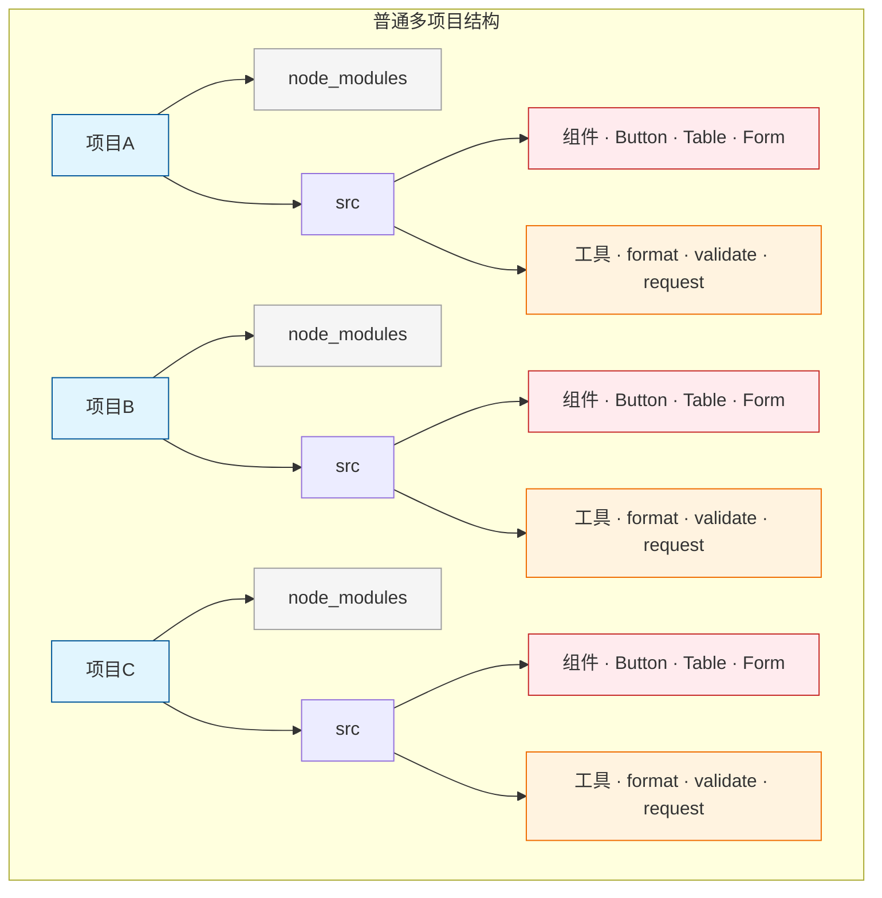
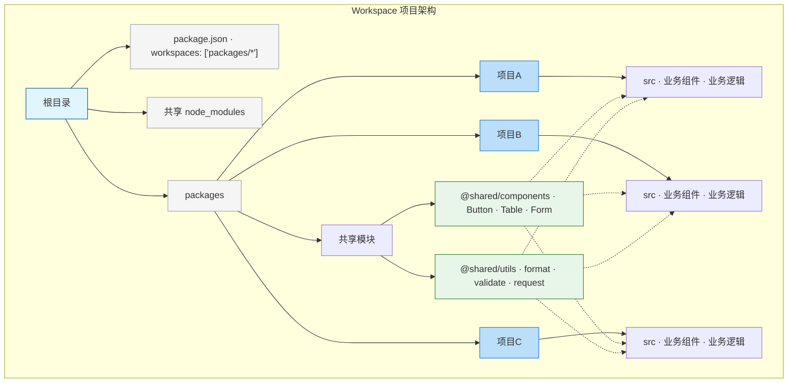
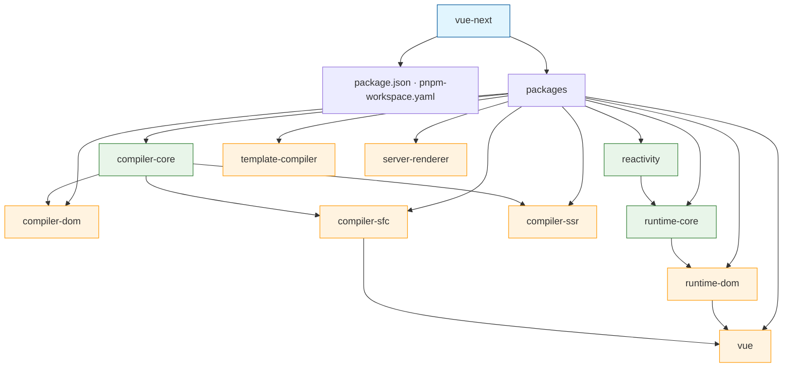
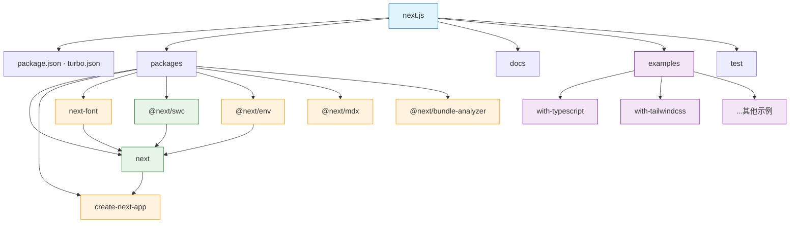

## 前言

网上常说的 monorepo，用 yarn workspace 就是一种落地方式。目标很直接：把多个项目里相同的部分抽到一处，少做重复开发，也少在拷贝粘贴里修同一处 bug。

本文按「问题 → 架构对比 → 流行库结构 → 手动搭建 → 依赖合并」拆开说明。

## 一、当前存在的问题

### 1. 相同功能组件重复实现

前端里同一个组件常在多个项目里各写一份。人一多、项目一散，更容易变成「同一套 Button / Table / Form，几个人各实现一遍」。靠拷贝共享，组件出问题就得反复复制修补。

### 2. 公共逻辑无法统一管理

公司常见 web + app 双端：界面不同，业务逻辑大量重合，却各写一套。后端若是 Node.js + TypeScript，API 类型前后端各定义一遍；表单校验也常是两端各写一份。项目一拆开，公共逻辑就很难统一演进。

## 二、普通项目与 workspace 架构对比

### 1. 普通多项目

相同逻辑或组件，各自仓库里各存一份：



编写和维护都要付多倍成本。

### 2. Workspace 项目

相同逻辑或组件放到共享包，业务项目只保留自己的部分：



## 三、流行库的项目结构

以下示意图在 AI 辅助下生成，并非基于当下最新源码，仅供参考结构思路。

### 1. Vue

前端常用的 Vue，大致是 monorepo 拆编译器、运行时、完整包等：



### 2. Next.js

服务端渲染很常见的 Next.js，也是多包 + examples：



Node 侧如 NestJS、Prisma 等，同样常见 workspace / monorepo 组织方式。

## 四、手动搭建 workspace

### 1. 初始化根项目

准备目录 `workspace-learn`，生成 `package.json`：

```bash
mkdir workspace-learn
cd workspace-learn
yarn init -y
```

得到类似：

```json
{
  "name": "workspace-learn",
  "version": "1.0.0",
  "main": "index.js",
  "license": "MIT"
}
```

workspace 根项目必须是私有的，加上：

```json
{
  "private": true
}
```

再建 `packages` 放子项目：

```bash
mkdir packages
```

目录此时是：

```text
workspace-learn
├── package.json
└── packages
```

还要在根 `package.json` 声明 workspaces（字段名是 `workspaces`，复数），Yarn 才会识别：

```json
{
  "workspaces": ["packages/*"]
}
```

放置目录不必叫 `packages`；有的仓库还会另开 `examples`。只是社区里用 `packages` 最常见。

### 2. 放入子项目

在 `packages` 下新建两个子项目目录 `one`、`two`：

```bash
cd packages
mkdir one two
```

各自补上自己的 `package.json`（`name` 要能被 `yarn workspace <name>` 引用）。

### 3. 给子项目加依赖

例如给 `one` 装 dayjs：

```bash
# yarn workspace [package.json 里的 name] add [依赖]
yarn workspace one add dayjs
```

移除：

```bash
yarn workspace one remove dayjs
```

## 五、yarn 依赖合并原则

安装方式可参考 [npm 依赖版本说明](https://docs.npmjs.com/cli/v6/using-npm/semver)。版本由 `[major, minor, patch]` 构成，详见 [semver](https://semver.org/lang/zh-CN/)：

| 段 | 含义 |
|----|------|
| major | 不兼容的变更 |
| minor | 兼容的新功能 |
| patch | 兼容的 bug 修复 |

库若遵循这套规则，只要不 bump major，通常可在同一大版本内合并。默认安装常写成 `"dayjs": "^1.11.13"`，`^` 表示会解析到 `1.11.13 <= dayjs < 2.0.0`。Yarn 合并依赖时也按这个区间思路处理。

例如：

```bash
yarn workspace one add dayjs@^1.11.13
yarn workspace two add dayjs@^1.11.12
```

两边都是 caret 范围，有机会合并到同一满足双方的版本。若写成精确版本、去掉 `^`：

```bash
yarn workspace one add dayjs@1.11.13
yarn workspace two add dayjs@1.11.12
```

则两个版本会并存，不会合并。

代码没改却突然跑不起来时，除了先核对 Node 版本，也要怀疑依赖区间合并带来的「静默升级」。

其它常见范围写法：

1. `^`：更新 minor / patch；major 为 0 时通常只动 patch；major、minor 都为 0 时更保守。见 [Caret Ranges](https://docs.npmjs.com/cli/v6/using-npm/semver#caret-ranges-123-062-004)。
2. `~`：通常只更新 patch。
3. `>=`：按规则可落到满足条件的较新版本。
4. 不写符号、写死版本：装指定版本；`dayjs@1` / `dayjs@1.x` 一类则落在该 major 的允许区间内。

## 结尾

yarn workspace 解决的是「多项目重复造轮子」：共享包放公共组件与逻辑，业务仓只留差异。搭好 `private` + `workspaces` 之后，真正要盯紧的是依赖版本范围——合并省空间，也可能在你没改代码时换掉实际装上的版本。
